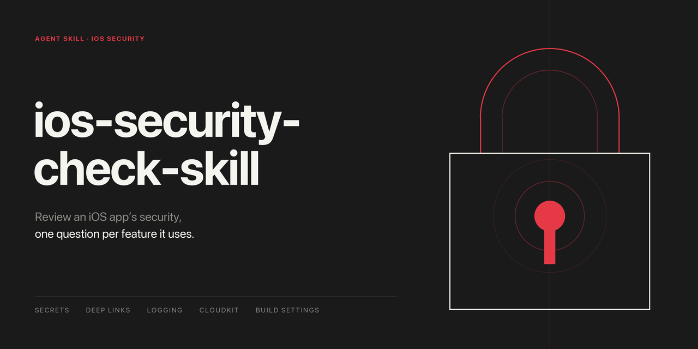

# ios-security-check-skill

[日本語](README.md) | English



## What is ios-security-check-skill?

An agent skill that reviews the security of an iOS, iPadOS, watchOS or macOS app written in Swift. It works in Claude Code and in Codex: both read the open [Agent Skills](https://agentskills.io) format, so the same folder serves either.

The premise is that most of an app's security questions are decided by what the app does. An app with no web view has no web view problems. So the review first finds out which features the app uses, then asks one question about each of those and skips the rest. That cuts the review down to what applies, and keeps it from reporting things that are not there.

The checklist has 33 items. Each one is tied to a source: Apple's developer documentation, the OWASP mobile standards, or both.

## About OWASP

OWASP, the Open Worldwide Application Security Project, is a nonprofit foundation that works to improve the security of software. Its projects are community-led, and its material is free and open to everyone. Its mobile standard describes itself as the industry standard for mobile app security.

This skill draws on three of its publications for mobile apps:

- **MASVS**, the Mobile Application Security Verification Standard: what an app should satisfy, set out as 24 controls.
- **MASTG**, the Mobile Application Security Testing Guide: the tests that check an app against that standard. The skill cites the current iOS tests by number.
- **Mobile Top 10**: the ten risks that turn up most often in mobile apps.

Where an item in the checklist names OWASP as its source, it appears in the standard or in the tests.

## What you can ask it

- **"Check this app's security."** The agent runs the bundled scan, reads the code at the places it points to, and reports what needs fixing, what you need to check yourself, and what it skipped because the app does not use it.
- **"We're about to ship. Anything I should fix first?"** The same review, ordered by consequence.
- **"I'm adding a URL scheme / a web view / file import. What do I need to get right?"** The agent opens the one item for that feature: what to look at, when it is a problem, when it is not, and which way the fix goes.
- **"Is it a problem that we don't have jailbreak detection or certificate pinning?"** The skill records what it deliberately leaves out, why, and when to bring each back.

It is a review, not a scanner, and it does not change your code unless you ask. The script only shows where to look; whether something is a problem is decided by reading the code.

## What it covers

| Group | When it applies | Items |
|---|---|---|
| Every app | Always | Transport security exceptions, unused entitlements, secrets in the repository, development-only switches in release builds, URL schemes with no handler, retiring old versions, Xcode build settings that ship development code |
| Features in use | Only when the app uses the feature | Deep links and other outside entry points, web views, file import, archive extraction, object unarchiving, database queries, UserDefaults, logging, databases and files with personal content, app groups, pasteboard, app-switcher snapshots of sensitive screens, fields for passwords and codes, crash and analytics SDKs, cached responses and cookies, notifications and widgets on the Lock Screen, content given to Spotlight and Handoff, custom certificate validation, CloudKit public database, App Attest, cryptography, sign-in / biometrics / Keychain / purchases, Mac targets |
| Server and supply chain | When the repository has them | Server-side code, keys that ship inside the app, third-party packages |

## What it leaves out

Jailbreak and debugger detection, obfuscation, certificate pinning, avoiding the pasteboard altogether, C-level memory-safety checks, looking up known vulnerabilities in packages, and whether data ends up in backups are left out on purpose. `references/not-checked.md` gives the reason for each and the condition under which to bring it back.

Privacy manifests, purpose strings and App Review compliance are a different review and are not part of this skill.

## Layout

```
README.md                                README in Japanese
README.en.md                             This file
SKILL.md                                 Workflow, the 33-item checklist, how to judge, report format
scripts/scan_features.py                 Lists the features an app uses, with file and line
references/every-app.md                  A1–A7: items for every app
references/untrusted-input.md            B1–B6: data coming in
references/data-exposure.md              B7–B17: data kept on the device or sent out
references/trust-and-identity.md         B18–B23: servers, CloudKit, attestation, crypto, sign-in, Mac
references/server-and-supply-chain.md    C1–C3
references/not-checked.md                What is left out, and why
assets/social-card-jp.png                Social card (Japanese)
assets/social-card-en.png                Social card (English)
```

`SKILL.md` is enough to start. A reference file is opened only when the app uses a feature it covers.

The skill body, the reference files and the script's output are written in Japanese. The report is written in the language of the person who asked.

## The scan script

```bash
python3 scripts/scan_features.py /path/to/your/project
```

It reads the project and prints which features are in use, with a few locations for each. It needs Python 3 and nothing else. It does not modify anything, does not use the network, and never prints the value of anything that looks like a secret: only the file, the line and the name it is assigned to.

For secrets it searches every text file in four ways: by shape, for services whose key format was confirmed in their own documentation (GitHub, GitLab, Slack, AWS, Stripe, and private-key blocks); by name, for values assigned to something called key, secret, token or password; by argument, for a quoted prefix-and-random string passed straight into a call, reported as a candidate because the script cannot tell what it is; and by file name, for signing keys, SSH keys and credential files. It does not know every service and it does not read git history. For that, the skill points to a dedicated secret scanner such as gitleaks.

A hit means "look here". It does not mean "this is a problem".

## Installation

The skill is one folder. Copy it to where your agent looks for skills, under the name `ios-security-check-skill`. The folder's name has to match the skill's name.

**Claude Code**

```bash
cp -R ios-security-check-skill ~/.claude/skills/ios-security-check-skill
```

For a single project, copy it to `<project>/.claude/skills/ios-security-check-skill` instead. Then ask for a security review, or type `/ios-security-check-skill`.

**Codex**

```bash
cp -R ios-security-check-skill ~/.agents/skills/ios-security-check-skill
```

For a single repository, copy it to `<repository>/.agents/skills/ios-security-check-skill` instead. Then ask for a security review, type `$ios-security-check-skill`, or pick it from `/skills`.

## Keeping your results

The skill holds the questions. The answers belong to your project. Record what the review finds in your project's own documentation, and do not put unfixed findings anywhere public.

## Sources

- Apple Developer Documentation: the pages linked from each item
- [OWASP MASVS](https://mas.owasp.org/MASVS/) and [MASTG](https://mas.owasp.org/MASTG/): the current iOS tests are cited by number
- [OWASP Mobile Top 10 2024](https://owasp.org/www-project-mobile-top-10/)
- [mobsfscan](https://github.com/MobSF/mobsfscan) and [Semgrep rules](https://github.com/semgrep/semgrep-rules): what static analysis flags in Swift
- [secure-ios-app-dev](https://github.com/felixgr/secure-ios-app-dev)

The text is written in this skill's own words. Nothing is copied from the OWASP material, which is licensed CC BY-SA 4.0.

## License

MIT
