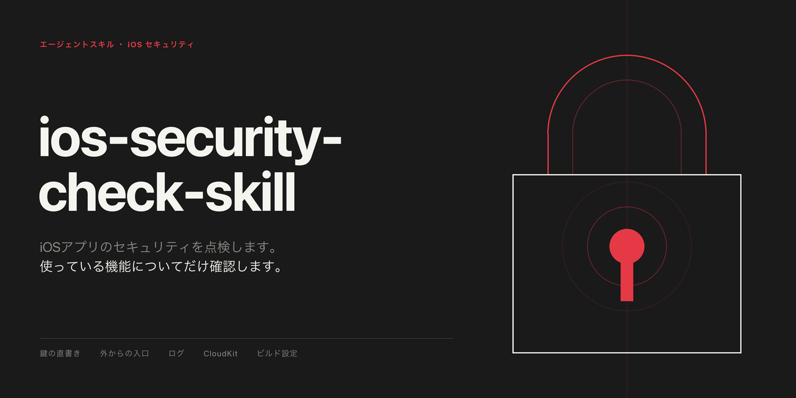

# ios-security-check-skill

日本語 | [English](README.en.md)



## ios-security-check-skill とは

Swift で書かれた iOS・iPadOS・watchOS・macOS のアプリについて、セキュリティを点検するためのスキルです。Claude Code と Codex の両方で使用できます。

**アプリのセキュリティで何を確認すべきかは、そのアプリが何をしているかでほぼ決まります。** アプリ内でウェブページを表示しないアプリには、ウェブ表示の問題はありません。そこで、まずアプリが使っている機能を調べ、使っている機能についてだけ問いを立てて確認します。そのため、確認する量が減り、存在しない問題を報告することもなくなります。

Apple の開発者向け文書と OWASP の基準をもとにした観点は、33 個あります。

## OWASP とは

OWASP（オワスプ）は、ソフトウェアのセキュリティを良くすることを目的にした、非営利の国際的な団体です。Open Worldwide Application Security Project の略です。

コミュニティが主導して作った基準や手引きを、誰でも無料で読める形で公開しています。モバイル向けの基準は、業界標準です。

このスキルは、モバイルアプリ向けの次の3つを使っています。

- **基準（MASVS）。** アプリが満たすべきことを 24 項目にまとめたものです。
- **テスト集（MASTG）。** その基準を満たしているかを確かめる手順の集まりです。このスキルは、現行の iOS 向けテストを番号で引いています。
- **Mobile Top 10。** モバイルアプリで特に多い危険を、10 個に絞って並べたものです。

## 依頼できること

- **「このアプリのセキュリティを点検して」** 付属のスクリプトで使っている機能を調べ、該当する箇所のコードを読み、直すべきこと・自分で確かめるべきこと・使っていないので飛ばしたことを報告します。
- **「もうすぐリリース。先に直すべきところはある？」** 同じ点検を、影響の大きい順に並べて返します。
- **「URL スキームやウェブ表示、ファイルの取り込みを足す。何に気をつければいい？」** その機能の観点だけを開き、何を見るか、どうなっていたら問題か、どうなっていれば問題ないか、直す方向を示します。
- **「改造された端末の検知や、接続先の証明書の固定が無いのは問題？」** 意図して点検から外しているものと、その理由、見直す条件を記録してあります。

これは点検であって、自動の検査ツールではありません。スクリプトが示すのは「どこを見るか」だけで、問題かどうかはコードを読んで判断します。依頼がない限り、コードを修正しません。

## 観点の一覧

### どのアプリでも確認する観点

| 観点 | 見ること |
|---|---|
| 通信の保護の設定 | 通信を HTTPS に限る仕組みを、緩める設定にしていないか |
| アプリに付けた権限 | 使っていない権限が付いたままになっていないか |
| 鍵やパスワードの直書き | コードやリポジトリに、鍵やトークンを書いていないか |
| 開発用の機能 | 開発中だけ使う機能が、配布するアプリに入っていないか |
| 使っていない URL スキーム | 登録だけして、受け取る処理が無いスキームが残っていないか |
| 古い版を使えなくする手段 | 古い版に無い保護に頼るとき、古い版を使えなくする手段があるか |
| Xcode のビルド設定 | 配布用のビルドに、開発用のコードが入る設定になっていないか |

### 使っている機能だけを確認する観点

左の欄の機能を使っていないアプリは、その機能の確認をスキップします。使っているかどうかは、付属のスクリプトがコードを検索して確かめます。

| 使っている機能 | 見ること |
|---|---|
| 外からアプリを開く入口 | URL・検索結果・通知から受け取った値を確かめているか。できる操作を絞っているか |
| アプリ内のウェブ表示 | 読み込む先を限っているか。端末内のファイルを読める範囲が広すぎないか |
| ファイルの取り込み | 取り込んだファイルの中身を、安全なものと決めつけていないか |
| 外から来た zip の展開 | 展開先のフォルダーの外に、ファイルが書き出されないか |
| 保存したオブジェクトの復元 | 外から来たデータを、安全な方式で復元しているか |
| データベース | 利用者の入力を、SQL の文に直接つなげていないか |
| 設定の保存 | 名前やメールアドレスなどの個人情報を、設定の保存先に置いていないか |
| ログの出力 | 利用者が入力した内容や声を、ログに出していないか |
| 個人情報を含むファイルやデータベース | 端末のロック中に読めないようにしているか |
| ウィジェットなどとのデータ共有 | 共有するデータを、必要なものだけに絞っているか |
| コピーとペースト | 個人情報をコピーするとき、期限と端末の限定を付けているか |
| 認証情報・お金・健康の情報を出す画面 | アプリを切り替えたときの縮小画面に、内容が写り込まないか |
| パスワードや確認コードの入力欄 | 入力した内容が隠れる専用の入力欄を使っているか |
| クラッシュ報告や利用状況の送信 | 外部のサービスに、利用者のデータを渡していないか |
| 通信の応答のキャッシュとクッキー | 個人情報を含む応答が、端末に保存されたままになっていないか |
| ロック画面に出る通知やウィジェット | ロック中でも見える場所に、個人情報を出していないか |
| 端末内の検索や Handoff に出す内容 | 個人的な内容を、端末の検索やほかの端末に渡していないか |
| サーバー証明書の独自の検証 | 標準の検証より緩くしていないか |
| CloudKit の公開データベース | 誰でもデータを作れる設定になっていないか。読んだ値を確かめているか |
| 正規のアプリかを確かめる仕組み | サーバー側で、確認を必須にしているか |
| 暗号の処理 | 古くて弱い方式を使っていないか。鍵をコードに書いていないか |
| ログイン・生体認証・課金 | 認証情報の保存先は安全か。判定をすり抜けられないか |
| Mac 向けのアプリ | アプリが触れる範囲を制限する仕組みを、有効にしているか |

### サーバーや外部サービスを使っているアプリだけ確認する観点

| 観点 | 見ること |
|---|---|
| サーバー側のプログラム | 受け取った値の型と長さを確かめているか。鍵を安全な場所に置いているか |
| アプリに入れて配る鍵 | 地図や決済、クラッシュ報告などの鍵に、そのアプリからしか使えない制限を付けているか。使う機能だけに絞っているか |
| 外部のパッケージ | 版を固定し、その記録をリポジトリに入れているか |

## 確認しないもの

- **改造された端末や解析の検知。** OWASP 自身が「無いこと自体は脆弱性ではない」としています。
- **接続先の証明書の固定。** Apple は任意の強化としています。自前のサーバーで個人情報を扱うようになったら見直します。
- **コピーとペーストの全面禁止。** 個人情報を扱うときだけ見れば足ります。
- **メモリの破壊などの古い種類の不具合。** C や Objective-C のコードを持つときだけ見ます。
- **外部のパッケージの既知の脆弱性の照合。** リポジトリの中だけでは調べられません。版を固定しているかまでを見ます。
- **バックアップに入るデータ。** Apple の文書が、バックアップから外す指定を「目安であって保証ではない」としているためです。

プライバシーの申告や審査への適合は、別の点検です。このスキルでは扱いません。

## 構成

```
README.md                                このファイル
README.en.md                             英語の README
SKILL.md                                 進め方、33 個の観点、判断の基準、報告の書式
scripts/scan_features.py                 アプリが使っている機能を、ファイルと行つきで一覧にする
references/every-app.md                  どのアプリでも確認する観点 7 個
references/untrusted-input.md            外から入ってくるデータ
references/data-exposure.md              端末に置くデータと、外に出ていくデータ
references/trust-and-identity.md         サーバー、CloudKit、正規のアプリの確認、暗号、ログイン、Mac
references/server-and-supply-chain.md    サーバー側と外部のパッケージ
references/not-checked.md                確認しないものと、その理由
assets/social-card-jp.png                ソーシャルカード（日本語）
assets/social-card-en.png                ソーシャルカード（英語）
```

スキルの本文と参考資料は日本語で書いてあります。報告は、頼んだ人の言葉で、専門用語に頼らずに返すよう指示してあります。

## スクリプト

```bash
python3 scripts/scan_features.py /path/to/your/project
```

プロジェクトを読み、使っている機能と、その場所をいくつか表示します。Python 3 だけで動きます。何も書き換えず、通信もしません。鍵らしい文字列を見つけても、値そのものは表示しません。表示するのは、ファイル・行・代入先の名前だけです。

鍵は、すべてのテキストファイルを対象に、4つの方法で探します。

- **形で探す。** 公式の文書で鍵の形を確かめられたサービスが対象です。GitHub・GitLab・Slack・AWS・Stripe と、秘密鍵のブロックです。
- **名前で探す。** サービスを問わず、key・secret・token・password といった名前に、乱数のような長い文字列が代入されていれば拾います。
- **引数で探す。** 関数の引数に直接書かれた、接頭辞つきの乱数らしい文字列です。何の値かは分からないので、候補として挙げます。
- **ファイル名で探す。** 署名の鍵、SSH の秘密鍵、認証情報を書くファイルです。名前だけを挙げ、中身は開きません。

すべてのサービスの鍵の形を知っているわけではありません。git の履歴の中身も読みません。そこまで調べるときは、gitleaks などの専用の検査ツールを使うよう、スキルが案内します。

見つかった箇所は「ここを見る」という意味で、「ここが問題」という意味ではありません。

## インストール

スキルは1つのフォルダーです。使っているエージェントがスキルを探す場所へ、`ios-security-check-skill` という名前でコピーします。フォルダーの名前は、スキルの名前と同じにする必要があります。

**Claude Code**

```bash
cp -R ios-security-check-skill ~/.claude/skills/ios-security-check-skill
```

特定のプロジェクトだけで使う場合は、`<project>/.claude/skills/ios-security-check-skill` にコピーします。そのうえで、セキュリティの点検を頼むか、`/ios-security-check-skill` と入力します。

**Codex**

```bash
cp -R ios-security-check-skill ~/.agents/skills/ios-security-check-skill
```

特定のリポジトリだけで使う場合は、`<repository>/.agents/skills/ios-security-check-skill` にコピーします。そのうえで、セキュリティの点検を頼むか、`$ios-security-check-skill` と入力します。`/skills` から選ぶこともできます。

## 点検の結果の置き場所

このスキルが持つのは「問い」です。「答え」は、点検したアプリのものです。見つかったことは、そのアプリのリポジトリの文書に記録してください。まだ直していない問題を、誰でも読める場所に置かないでください。

## 出どころ

- Apple の開発者向け文書（各観点からリンクしています）
- [OWASP MASVS](https://mas.owasp.org/MASVS/) と [MASTG](https://mas.owasp.org/MASTG/)（現行の iOS 向けテストを番号で引いています）
- [OWASP Mobile Top 10 2024](https://owasp.org/www-project-mobile-top-10/)
- [mobsfscan](https://github.com/MobSF/mobsfscan) と [Semgrep のルール](https://github.com/semgrep/semgrep-rules)
- [secure-ios-app-dev](https://github.com/felixgr/secure-ios-app-dev)

文章はすべてこのスキルの言葉で書いています。OWASP の資料（CC BY-SA 4.0）からの転載はありません。

## ライセンス

MIT
